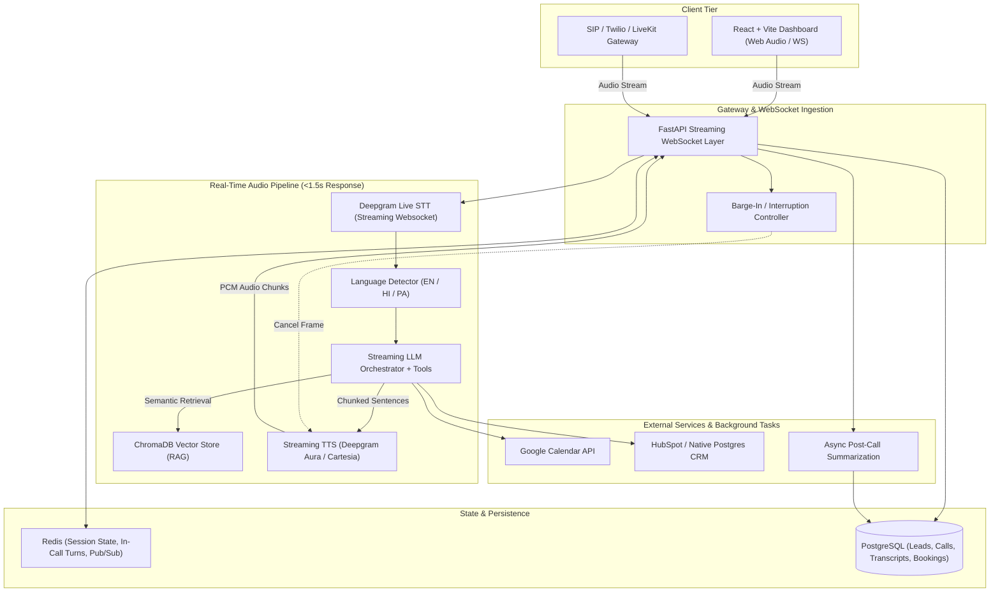

# VoxSell Architecture & Technical Documentation

## High-Level Architecture Diagram

## Architectural Rationale for Scaling (100,000+ Concurrent Scale)
1. **Stateless API/WebSocket Pods**: All active call state and transient audio buffers reside in Redis clusters, allowing horizontal autoscaling behind AWS ALB / Envoy without sticky session fragility.
2. **Streaming Chunk Pipeline**: Audio is not held until speech ends. Streaming transcription triggers speculative LLM sentence completion, feeding TTS before the entire thought finishes, dropping latency under 1.5 seconds.
3. **Decoupled Post-Call Workflows**: BANT scoring finalization, embedding generation, and CRM webhooks execute out-of-band in worker queues (Celery / Redis Streams), keeping the real-time audio thread completely unblocked.
